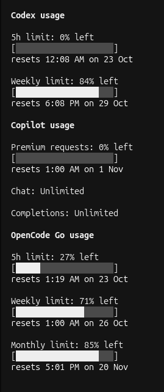

# usage

OpenCode V2 plugin displaying ChatGPT/Codex, GitHub Copilot, and OpenCode Go usage limits.




## Install

Clone the repository into OpenCode's global plugin directory:

```sh
git clone https://github.com/xhargh/OpenCodeUsage.git ~/.config/opencode/plugins/usage
```

OpenCode auto-discovers plugin packages under `~/.config/opencode/plugins/`. Restart the terminal UI after installing (or run `opencode service restart`). The sidebar is only visible when the terminal is wide enough.

You can also install it as a managed package plugin:

```sh
opencode plugin add github:xhargh/OpenCodeUsage
```

## Features

- **Sidebar:** remaining limits, 20-cell bars, and local reset times. Refreshes every minute and after completed turns.
- **Copilot:** appears below Codex with AI-credit usage (`used / total`) and premium-request, chat, and completion quotas. Unlimited quotas are labeled explicitly, without a misleading percentage or reset time. Provider errors are independent.
- **OpenCode Go:** appears below Copilot with 5-hour, weekly, and monthly allowances from the Console's Go meters (Go or Go Plus). No hardcoded plan prices or locally estimated spend.
- **`/usage`:** fetches fresh limits and shows them once in a dismissible dialog (Esc or click outside), without invoking a model or adding a message to the conversation.
- **Visibility:** each provider's section appears only when that provider is both connected and enabled in OpenCode. Signed-out or disabled providers are omitted entirely.

## Connections

Uses OpenCode's active `openai` OAuth connection. Sign in with ChatGPT through `/connect`; API-key billing does not provide Codex subscription limits. Credentials stay on the server, are resolved through OpenCode, and are never sent to the UI or written by this plugin.

Copilot uses the active `github-copilot` connection (OAuth or GitHub token), also configured through `/connect`. Usage reporting currently supports GitHub.com accounts, not GitHub Enterprise deployments.

Go uses your active **OpenCode Console** connection (`opencode`) first, falling back to an `opencode-go` API key when no Console account is connected. The account-scoped Go status includes the 5-hour, weekly, and monthly meters, so no workspace selection is needed. Custom Console servers are not supported. If an API key has expired, the sidebar says so; create a new key in the Console and reconnect it, or sign in with **OpenCode Console**.

## Notes

The ChatGPT usage, GitHub `copilot_internal/user`, and Console `/api/go/status` endpoints are undocumented and may change. Fetch/authentication errors are shown rather than inventing percentages. Different Codex window lengths are labeled using their actual durations. `/usage` shows Codex first, then Copilot, then OpenCode Go. An idle Go 5-hour window may not yet have a reset timestamp; this is displayed as unknown.

## Development

Run tests with `npm test` in this directory.
